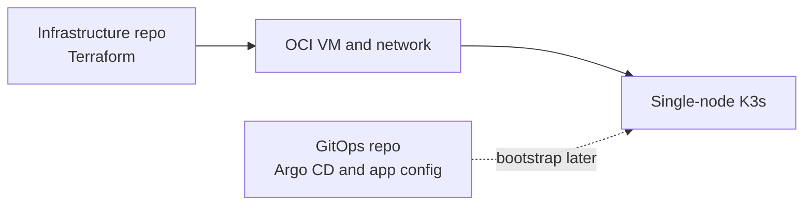
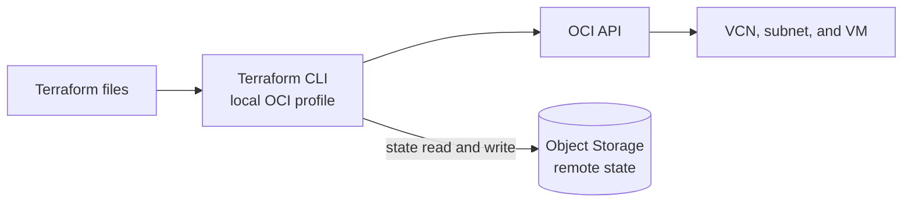
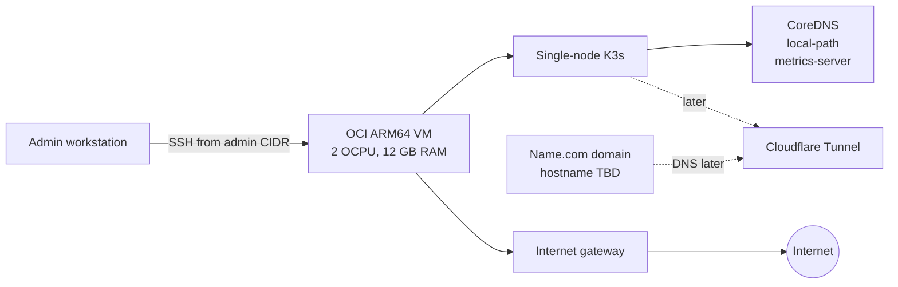

# Oracle k3s infrastructure

This repository uses Terraform to manage the Oracle Cloud Infrastructure (OCI)
VM and network for the disease-prediction project. Kubernetes applications and
cluster configuration live in `disease-prediction-gitops`.

## Current setup

Checked on 2026-10-29:

- One ARM64 `VM.Standard.A1.Flex` VM in Frankfurt AD-2, with 2 OCPUs and 12 GB
  RAM.
- Oracle Linux 9.8 with K3s `v1.37.1+k3s1`.
- One 200 GB boot volume and one full boot-volume backup.
- During the Tailscale migration, public SSH is limited to `admin_ssh_cidr`.
  Kubernetes and application ports are closed to the internet.

The VM uses the Always Free A1 compute and block storage limits: 2 OCPUs, 12 GB
RAM, 200 GB of combined boot and block storage, and up to five volume backups.
These limits apply across the tenancy. Check **Limits, Quotas and Usage** before
adding resources.
[OCI Always Free limits](https://docs.oracle.com/en-us/iaas/Content/FreeTier/freetier_topic-Always_Free_Resources.htm)

## Architecture

Each diagram shows one view. Dashed arrows show work planned for later.

### Repositories



### Terraform provisioning



### Cluster access



Only SSH from `admin_ssh_cidr` is open to the internet. Argo CD, application workloads,
the tunnel, and domain records are later work.

## Requirements

- Terraform 1.17.1, matching CI. The OCI provider is pinned to 9.11.0 in
  `versions.tf` and `.terraform.lock.hcl`.
- OCI CLI configured with a local `DEFAULT` API signing-key profile.
- An SSH key pair. A public IPv4 address is needed only for temporary SSH
  access before Tailscale is ready.

Terraform uses your local OCI profile. Keep the API private key and SSH private
key out of this repository.

## Set up a local checkout

Run these commands from the repository root. Copy the example variables file,
then fill in its values:

```powershell
Set-Location terraform/oracle
Copy-Item terraform.tfvars.example terraform.tfvars
```

Set the exact availability-domain name and an ARM64 Linux image OCID from
Frankfurt. Set `ssh_public_key_path` to your public key file and, while using
public SSH, set `admin_ssh_cidr` to your current public IP with `/32`. After
Tailscale works from your laptop, set `admin_ssh_cidr = null` to remove public
SSH. The VCN, subnet, and VM are already in remote state, so their OCIDs are not
needed in `terraform.tfvars`.

Initialize Terraform with the existing private, versioned Object Storage bucket:

```powershell
$namespace = (oci os ns get | ConvertFrom-Json).data
terraform init `
  -backend-config="bucket=disease-prediction-tfstate" `
  -backend-config="namespace=$namespace" `
  -backend-config="region=eu-frankfurt-1" `
  -backend-config="key=disease-prediction/terraform.tfstate" `
  -backend-config="config_file_profile=DEFAULT"
```

Keep this state bucket. State and saved plans can contain sensitive values;
never commit them or `terraform.tfvars`.

## Modify and apply changes

Change input values in `terraform.tfvars` and resource settings in the `.tf`
files. Avoid making changes only in the OCI Console; a later Terraform apply may
overwrite them. Before Tailscale is ready, keep `admin_ssh_cidr` set to your
current `/32`; after private access is confirmed, set it to `null`.

The `k3s_version` input is used by cloud-init on the VM's first boot. Changing
it does not update a running VM; use the VM replacement steps below to install
another version.

Run these commands from `terraform/oracle`:

```powershell
terraform fmt -check -recursive
terraform validate
terraform plan -out=infra.tfplan
terraform show infra.tfplan
```

Review the plan before applying it:

```powershell
terraform apply infra.tfplan
Remove-Item infra.tfplan
```

When the cloud matches this repository, the plan should show no changes. Stop
and review unexpected replacements or deletions. The VM, VCN, and public subnet
have `prevent_destroy` guards.

## Set up private access and check K3s

Install and verify Tailscale by following the [GitOps Tailscale guide](https://github.com/Disease-Prediction-ASET26/disease-prediction-gitops/blob/main/docs/operations/tailscale.md).
Keep `admin_ssh_cidr` set until SSH and the Kubernetes tunnel both work over the
tailnet. Then set `admin_ssh_cidr = null` in `terraform.tfvars` and review the
plan. It should remove only the public SSH ingress rule from
`oci_core_security_list.public`; it must not replace or destroy the VM, VCN, or
subnet. Apply only after checking the plan.

Connect to the VM by its Tailscale MagicDNS name:

```powershell
ssh -i "$env:USERPROFILE\.ssh\disease-prediction-oci.key" opc@oracle-k3s
```

To restore public SSH for recovery, set `admin_ssh_cidr` to your current public
IPv4 `/32`, review and apply the Terraform plan, then verify SSH before changing
Tailscale or its tailnet policy.

On the VM, check cloud-init, K3s, and the node:

```sh
sudo cloud-init status --long
sudo systemctl is-active k3s
sudo /usr/local/bin/k3s kubectl get nodes
sudo /usr/local/bin/k3s kubectl get pods -A
```

Cloud-init runs when the VM first boots. Editing the cloud-init template does
not update a running VM.

## Replace the VM

Back up any data you need before a rebuild. The 200 GB boot volume uses the full
free storage allowance. `preserve_boot_volume = false` deletes that volume when
Terraform destroys the VM.

1. Temporarily remove `prevent_destroy` from `oci_core_instance.k3s_server`.
   Keep the VCN and subnet guards.
2. Create and review a VM-only destroy plan:

   ```powershell
   terraform plan -destroy -target=oci_core_instance.k3s_server -out=destroy.tfplan
   terraform show destroy.tfplan
   ```

   Apply only if the plan contains one action: destroy
   `oci_core_instance.k3s_server`.

   ```powershell
   terraform apply destroy.tfplan
   Remove-Item destroy.tfplan
   ```

3. Wait until the old boot volume is `TERMINATED`. Restore the VM destroy guard,
   then run a normal plan and apply to create the replacement.

## Remove the VM or the full stack

To remove only the VM and keep the network, remove
`oci_core_instance.k3s_server` and its outputs from the Terraform configuration.
Review a normal plan and apply it only if the VM is the only resource to be
destroyed. For example:

```powershell
terraform plan -out=remove-vm.tfplan
terraform show remove-vm.tfplan
terraform apply remove-vm.tfplan
Remove-Item remove-vm.tfplan
```

If the VM resource remains in the configuration, a later apply will create it
again.

To destroy the full stack, back up any data you need. Remove the
`prevent_destroy` guards from the VM, VCN, and public subnet in a reviewed
teardown change. Create and inspect a saved destroy plan:

```powershell
terraform plan -destroy -out=destroy.tfplan
terraform show destroy.tfplan
terraform apply destroy.tfplan
Remove-Item destroy.tfplan
```

Apply only when the plan lists the resources you intend to delete. The Object
Storage state bucket is outside this configuration; keep it until the teardown
is complete and you no longer need the state. If the teardown is permanent,
remove the Terraform resource blocks too, or a later apply will recreate the
stack.

Keep active boot and block storage at or below 200 GB and volume backups at or
below five.
