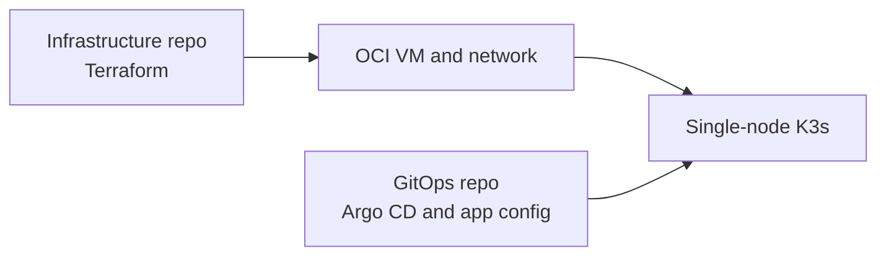
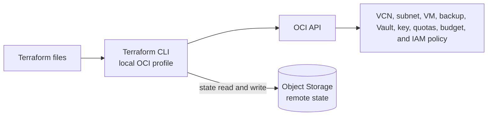
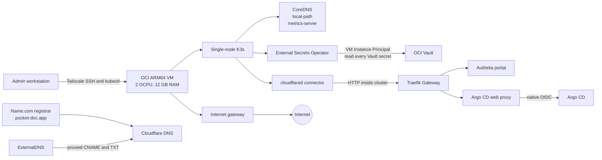

# Oracle k3s infrastructure

This repository uses Terraform to manage the Oracle Cloud Infrastructure (OCI)
VM and network for the disease-prediction project. Kubernetes applications and
cluster configuration live in `disease-prediction-gitops`.

## Current setup

Checked on 2026-10-31:

- One ARM64 `VM.Standard.A1.Flex` VM in Frankfurt AD-2, with 2 OCPUs and 12 GB
  RAM.
- Oracle Linux 9.8 with K3s `v1.37.1+k3s1`.
- One 200 GB boot volume and one full baseline backup. The backup is not
  recurring and does not replace application-level backups.
- Tailscale SSH and Kubernetes API access work; `admin_ssh_cidr` is `null`, so
  the OCI security list allows no inbound SSH, Kubernetes API, HTTP, or HTTPS.
- The Authelia portal and Argo CD UI have public hostnames through the outbound
  Cloudflare Tunnel. Argo CD requires Authelia OIDC; no product workload route
  is published.

The VM still has a public IPv4 address in a public subnet. Inbound access is
controlled by the OCI security list; outbound traffic is open for updates,
image pulls, and the Cloudflare Tunnel. Public subnet placement does not itself
mean that an application port is exposed.

## Security and recovery limits

- Cloud-init downloads the K3s install script from `get.k3s.io` over HTTPS and
  pins the K3s release passed to that script. The installer script itself is
  not independently checksum-verified.
- The remote Terraform state bucket is private and versioned. Terraform state
  can still contain sensitive data; restrict OCI access to the bucket and keep
  saved plan files out of Git.
- Terraform creates one baseline boot-volume backup, not an ongoing backup
  schedule. It does not replace off-VM, application-consistent backups or a
  tested restore.
- The `admin_ssh_cidr` guard accepts CIDRs as broad as `/24`; use your own
  public IPv4 `/32` for temporary SSH and set the value to `null` after
  Tailscale SSH is verified.

The VM uses the Always Free A1 compute and block storage limits: 2 OCPUs, 12 GB
RAM, 200 GB of combined boot and block storage, and up to five volume backups.
These limits apply across the tenancy. Check **Limits, Quotas and Usage** before
adding resources.
[OCI Always Free limits](https://docs.oracle.com/en-us/iaas/Content/FreeTier/freetier_topic-Always_Free_Resources.htm)

The Terraform configuration defines a standard OCI Vault and an HSM-backed AES
key for Kubernetes secrets. A dynamic group matches only the K3s VM. Its policy
can read every secret in that Vault; it is not limited to the secret names
selected by ESO. OCI Instance Principal is a VM identity, so any pod that can
reach the instance metadata endpoint may use this permission. Restrict and
verify metadata access before running untrusted workloads. The Vault OCID and
region are non-secret outputs used by ESO.

## Always Free guardrails

The Terraform configuration defines tenancy-wide quota policies for Compute,
Block Volume, and Object Storage, plus a monthly budget of 1 in the tenancy
billing currency with actual-spend and forecast alerts. These controls take
effect only after a reviewed Terraform plan is applied.
The quota policies allow A1 compute only in the selected home-region AD, cap it
at 2 OCPUs and 12 GB, cap boot and block storage at 200 GB in that AD, cap
volume backups at five in the home region, and cap Object Storage at 20 GB in
the home region. They apply across the tenancy, including child compartments.
Other Compute shapes and those storage services outside the selected allowance
are blocked. Check the plan carefully because these policies intentionally
restrict future resource creation throughout the tenancy. See OCI's
[quota policy syntax](https://docs.oracle.com/en-us/iaas/Content/Quotas/Concepts/quota_policy_syntax.htm)
for how these tenancy-wide statements are evaluated.

The VM already uses the full A1 compute and Block Volume capacity allowances.
The configuration keeps boot-volume performance at 10 VPUs/GB. OCI meters
performance separately from volume capacity, so inspect Cost Analysis for the
Block Volume Performance SKU (`B91962`) and compare it with the
[OCI price list](https://www.oracle.com/cloud/price-list/). Treat a line item
as chargeable unless Cost Analysis shows that the tenancy's free allowance
offsets it. The Always Free HSM allowance is 20 key versions across the
tenancy; do not rotate or replace the HSM key without checking remaining
versions first.

OCI's Always Free outbound transfer allowance is 10 TB/month. The quota
policies here do not cap outbound data transfer. [OCI budget alerts](https://docs.oracle.com/en-us/iaas/Content/Billing/Concepts/budgetsoverview.htm)
are evaluated periodically (about once every 24 hours) and are soft limits:
they notify but do not stop resources or charges. These policies do not cap
charges from services outside the listed resource types, so review Cost
Analysis after changes and regularly during operation.

The Terraform Object Storage quota also covers the versioned state bucket and
other Object Storage in the home region. Version history consumes storage. If
the 20 GB quota is reached, OCI can reject writes, including Terraform state
updates; review old object versions before the bucket approaches the limit.

The budget, alert rules, and quota policies use `prevent_destroy`. To remove
them, make a reviewed change that deliberately removes those guards. A full
stack destroy must not remove these controls accidentally.

## Architecture

Each diagram shows one view. Dashed arrows mark services that are not currently
deployed in OCI or exposed to the public Internet.

### Repositories



### Terraform provisioning



### Cluster access and platform services



Public SSH is disabled because Tailscale access is verified. The OCI security
list exposes no inbound SSH, Kubernetes API, HTTP, or HTTPS ports. Approved
public routes travel through Cloudflare and the outbound Tunnel to Traefik;
the Authelia portal and Authelia-protected Argo CD UI are published. No product
workload route is published. Argo CD and cluster configuration are managed in
the GitOps repository. See its
[domain and ingress guide](https://github.com/Disease-Prediction-ASET26/disease-prediction-gitops/blob/main/docs/operations/domain-ingress.md).

## Requirements

- Terraform 1.17.1, matching CI. The OCI provider is pinned to 9.11.0 in
  `versions.tf` and `.terraform.lock.hcl`. Install Terraform on Linux using the
  [official guide](https://developer.hashicorp.com/terraform/install), then
  check it with `terraform version`.
- OCI CLI installed and configured with a local `DEFAULT` API signing-key
  profile. Follow the [OCI CLI Linux install guide](https://docs.oracle.com/en-us/iaas/Content/API/SDKDocs/cliinstall.htm),
  then run `oci setup config` and choose the `DEFAULT` profile.
- The OCI identity used by Terraform must be allowed to manage quota policies
  and budgets in the root compartment, in addition to the project resources.
- An SSH key pair. A public IPv4 address is needed only for temporary SSH
  access before Tailscale is ready.

Terraform uses your local OCI profile. Keep the API private key and SSH private
key out of this repository.

## Set up a local checkout

Run these commands from the repository root. Copy the example variables file,
then fill in its values:

```bash
cd terraform/oracle
cp terraform.tfvars.example terraform.tfvars
```

Set the exact availability-domain name and an ARM64 Linux image OCID from
Frankfurt. Set `ssh_public_key_path` to the absolute path of your public key
file. While using public SSH, set `admin_ssh_cidr` to your current public IP
with `/32`. After
Tailscale works from your laptop, set `admin_ssh_cidr = null` to remove public
SSH. Set `budget_alert_email` to an address you check. The value belongs in the
ignored local `terraform.tfvars`; it is not a credential, but it is personal
information. The VCN, subnet, and VM are already in remote state, so their OCIDs
are not needed in `terraform.tfvars`.

### Bootstrap the remote state bucket

The remote state bucket is deliberately not managed by this Terraform state:
Terraform needs the bucket before it can initialize this backend. Create it
once, separately, in the tenancy home region and root compartment. Do not add
the bucket to `main.tf` or delete it during a project stack teardown.

First check whether the existing bucket is present. Create it only if it is
missing. The bucket must use Standard storage, remain private, and have object
versioning enabled:

```bash
OCI_TENANCY_OCID="ocid1.tenancy.oc1..replace-me"
OCI_HOME_REGION="eu-frankfurt-1"
TF_STATE_BUCKET="disease-prediction-tfstate"
OCI_NAMESPACE=$(oci os ns get --region "$OCI_HOME_REGION" --query data --raw-output)

oci os bucket get \
  --namespace-name "$OCI_NAMESPACE" \
  --name "$TF_STATE_BUCKET" \
  --region "$OCI_HOME_REGION"
```

If the bucket is missing, create it with these settings:

```bash
oci os bucket create \
  --namespace-name "$OCI_NAMESPACE" \
  --compartment-id "$OCI_TENANCY_OCID" \
  --name "$TF_STATE_BUCKET" \
  --storage-tier Standard \
  --public-access-type NoPublicAccess \
  --versioning Enabled \
  --region "$OCI_HOME_REGION"
```

If it exists but versioning is disabled or suspended, enable it:

```bash
oci os bucket update \
  --namespace-name "$OCI_NAMESPACE" \
  --name "$TF_STATE_BUCKET" \
  --versioning Enabled \
  --region "$OCI_HOME_REGION"
```

You can do the same bootstrap in the OCI Console: select the home region, open
**Object Storage & Archive Storage → Buckets**, and create a Standard bucket in
the root compartment with **No Public Access** and **Enable object versioning**.
Object versioning cannot be disabled after it has been enabled; it can only be
suspended. Keep the bucket and its previous state versions while the project
uses this backend.

### Initialize Terraform

Initialize Terraform with that private, versioned bucket:

```bash
OCI_HOME_REGION="eu-frankfurt-1"
TF_STATE_BUCKET="disease-prediction-tfstate"
OCI_NAMESPACE=$(oci os ns get --region "$OCI_HOME_REGION" --query data --raw-output)

terraform init \
  -backend-config="bucket=${TF_STATE_BUCKET}" \
  -backend-config="namespace=${OCI_NAMESPACE}" \
  -backend-config="region=${OCI_HOME_REGION}" \
  -backend-config="key=disease-prediction/terraform.tfstate" \
  -backend-config="config_file_profile=DEFAULT"
```

Keep this state bucket. State and saved plans can contain sensitive values;
never commit them or `terraform.tfvars`.

### Import existing resources before applying

The one-time full baseline boot-volume backup is represented by
`oci_core_boot_volume_backup.baseline`. Import its existing OCID before the
first plan so Terraform does not create a duplicate backup:

```bash
terraform import oci_core_boot_volume_backup.baseline "<BOOT_VOLUME_BACKUP_OCID>"
```

Before applying the guardrails, inspect **Billing & Cost Management → Budgets**
and **Governance & Administration → Quota policies**. OCI allows one budget per
target compartment, and quota policy names are unique and immutable across the
tenancy. Import an existing root budget before planning. Import a quota policy
if it already has the configured name; if you adopt an equivalent policy with
a different name, first change the Terraform `name` to match its immutable
name. Review existing quota statements and resource usage in **Limits, Quotas
and Usage** first; the quota policies below apply across the tenancy and
intentionally block other Compute shapes and storage outside the defined
allowance.

Use these import addresses for any existing matching controls:

```bash
terraform import oci_budget_budget.root_monthly "<BUDGET_OCID>"
terraform import oci_limits_quota.always_free_compute "<COMPUTE_QUOTA_OCID>"
terraform import oci_limits_quota.always_free_block_storage "<BLOCK_STORAGE_QUOTA_OCID>"
terraform import oci_limits_quota.always_free_object_storage "<OBJECT_STORAGE_QUOTA_OCID>"
```

Import any existing alert rules that match the four configured budget rules as
well. The alert rule import ID includes both the budget and alert rule OCIDs:

```bash
terraform import 'oci_budget_alert_rule.root_monthly["actual_50"]' \
  "budgets/<BUDGET_OCID>/alertRules/<ALERT_RULE_OCID>"
```

Repeat with `actual_100`, `forecast_50`, and `forecast_100` for the other
matching rules. Check that imported resources and policies have the intended
settings before apply.

Run `terraform plan -out=infra.tfplan` and inspect it before applying. The plan
may add the quota policies, budget, and alert rules; it must not replace the
VM, VCN, subnet, Vault, key, or create a second backup. Quota policies can take
up to ten minutes to become effective after apply.

## Modify and apply changes

Change input values in `terraform.tfvars` and resource settings in the `.tf`
files. Avoid making changes only in the OCI Console; a later Terraform apply may
overwrite them. Before Tailscale is ready, keep `admin_ssh_cidr` set to your
current `/32`; after private access is confirmed, set it to `null`.

The `k3s_version` input is used by cloud-init on the VM's first boot. Changing
it does not update a running VM; use the VM replacement steps below to install
another version.

Run these commands from `terraform/oracle`:

```bash
terraform fmt -check -recursive
terraform validate
terraform plan -out=infra.tfplan
terraform show infra.tfplan
```

Review the plan before applying it:

```bash
terraform apply infra.tfplan
rm infra.tfplan
```

When the cloud matches this repository, the plan should show no changes. Stop
and review unexpected replacements or deletions. The VM, VCN, and public subnet
have `prevent_destroy` guards.

## OCI Vault for Kubernetes secrets

The Terraform configuration creates a standard Vault and an HSM-backed AES
master key. It also creates a dynamic group that matches only the K3s instance
and a policy that permits that instance to read every secret in this Vault.
ESO's `ExternalSecret` resources select which values it copies; they do not
narrow the VM's OCI permission. The instance principal is a VM-level identity:
any pod able to reach the instance metadata service may be able to use it.
Keep the policy read-only and dedicate this Vault to the cluster.

Before the first apply, check OCI **Vault** resources and the Terraform state
for an existing project Vault. Import an existing matching Vault, key, dynamic
group, or policy instead of creating duplicates. From `terraform/oracle`,
review the saved plan and confirm it adds only the Vault, key, dynamic group,
and policy. It must not replace the VM, VCN, or subnet:

```bash
terraform state list
terraform plan -out=infra.tfplan
terraform show infra.tfplan
```

Apply only after reviewing the plan:

```bash
terraform apply infra.tfplan
rm infra.tfplan
terraform output secrets_vault_id
terraform output secrets_vault_region
```

These outputs are resource metadata, not credentials. Configure External
Secrets Operator with the Vault OCID and region, and use OCI Instance
Principal authentication. Do not manage secret payloads with Terraform:
Terraform state can contain resource inputs. Add and update secret values
through the OCI Console or another secure, non-logged method. Never put them
in `terraform.tfvars`, Git, a shell command literal, or logs.

To rotate a value, create a new secret version in OCI Vault and confirm ESO
refreshes the Kubernetes Secret. To remove a secret, first remove its
`ExternalSecret` consumer and synced Kubernetes Secret, then schedule deletion
of the OCI secret in Vault. Keep Vault and key deletion protected while any
secret or cluster still depends on them.

To deliberately remove the Vault after all consumers and secret versions are
gone, use a reviewed change to remove the Vault and key `prevent_destroy`
guards. Then create and inspect a destroy plan. Apply only if it removes the
intended Vault, key, dynamic group, and policy, with no VM or network changes.
OCI may retain scheduled deletions for a waiting period; follow the Vault
state before removing the resources from Terraform.

## Set up private access and check K3s

Install and verify Tailscale by following the [GitOps Tailscale guide](https://github.com/Disease-Prediction-ASET26/disease-prediction-gitops/blob/main/docs/operations/tailscale.md).
Keep `admin_ssh_cidr` set until SSH and the Kubernetes tunnel both work over the
tailnet. Then set `admin_ssh_cidr = null` in `terraform.tfvars` and review the
plan. It should remove only the public SSH ingress rule from
`oci_core_security_list.public`; it must not replace or destroy the VM, VCN, or
subnet. Apply only after checking the plan.

Connect to the VM by its Tailscale MagicDNS name:

```bash
chmod 600 "$HOME/.ssh/disease-prediction-oci.key"
ssh -i "$HOME/.ssh/disease-prediction-oci.key" opc@oracle-k3s
```

To restore public SSH for recovery, set `admin_ssh_cidr` to your current public
IPv4 `/32`, review and apply the Terraform plan, then verify SSH before changing
Tailscale or its tailnet policy.

On the VM, check cloud-init, K3s, and the node:

```sh
sudo cloud-init status --long
sudo systemctl is-active k3s
sudo /usr/local/bin/k3s kubectl get nodes
sudo /usr/local/bin/k3s kubectl get pods -A
```

Cloud-init runs when the VM first boots. Editing the cloud-init template does
not update a running VM.

## Replace the VM

Back up any data you need before a rebuild. The configured 200 GB boot volume
uses the full free storage allowance. `preserve_boot_volume = false` deletes
that volume when Terraform destroys the VM. The managed one-time baseline
backup is tied to this boot volume, so delete that backup before replacing the
VM and create a new one after the replacement is running. This is not a
recurring backup schedule.

1. In a reviewed change, remove the
   `oci_core_boot_volume_backup.baseline` block and temporarily remove
   `prevent_destroy` from `oci_core_instance.k3s_server`. Keep the VCN and
   subnet guards. Run a normal plan; it should destroy only the managed backup.
   Apply that plan, then remove the Terraform plan file.
2. Create and review a VM-only destroy plan:

   ```bash
   terraform plan -destroy -target=oci_core_instance.k3s_server -out=destroy.tfplan
   terraform show destroy.tfplan
   ```

   Apply only if the plan contains one action: destroy
   `oci_core_instance.k3s_server`.

   ```bash
   terraform apply destroy.tfplan
   rm destroy.tfplan
   ```

3. Wait until the old boot volume is `TERMINATED`. Restore the VM destroy guard
   and re-add `oci_core_boot_volume_backup.baseline`. Run a normal plan and
   apply to create the replacement VM and its new baseline backup.

## Remove the VM or the full stack

To remove only the VM and keep the network, remove
`oci_core_instance.k3s_server`, `oci_core_boot_volume_backup.baseline`, and
the instance outputs from the Terraform configuration. This also deletes the
managed boot-volume backup. Review a normal plan and apply it only if the VM,
its boot volume, and that backup are the only resources to be destroyed. For
example:

```bash
terraform plan -out=remove-vm.tfplan
terraform show remove-vm.tfplan
terraform apply remove-vm.tfplan
rm remove-vm.tfplan
```

If the VM resource remains in the configuration, a later apply will create it
again.

To destroy the full stack, back up any data you need. The budget, alert rules,
quota policies, VM, boot-volume backup, VCN, public subnet, Vault, and key all
have `prevent_destroy` guards. Remove those guards in a reviewed teardown
change. Create and inspect a saved destroy plan:

```bash
terraform plan -destroy -out=destroy.tfplan
terraform show destroy.tfplan
terraform apply destroy.tfplan
rm destroy.tfplan
```

Apply only when the plan lists the resources you intend to delete. The Object
Storage state bucket is outside this configuration; keep it until the teardown
is complete and you no longer need the state. If the teardown is permanent,
remove the Terraform resource blocks too, or a later apply will recreate the
stack. Retain the state bucket and its versions until Terraform no longer needs
the backend.

Keep active boot and block storage at or below 200 GB and volume backups at or
below five.
